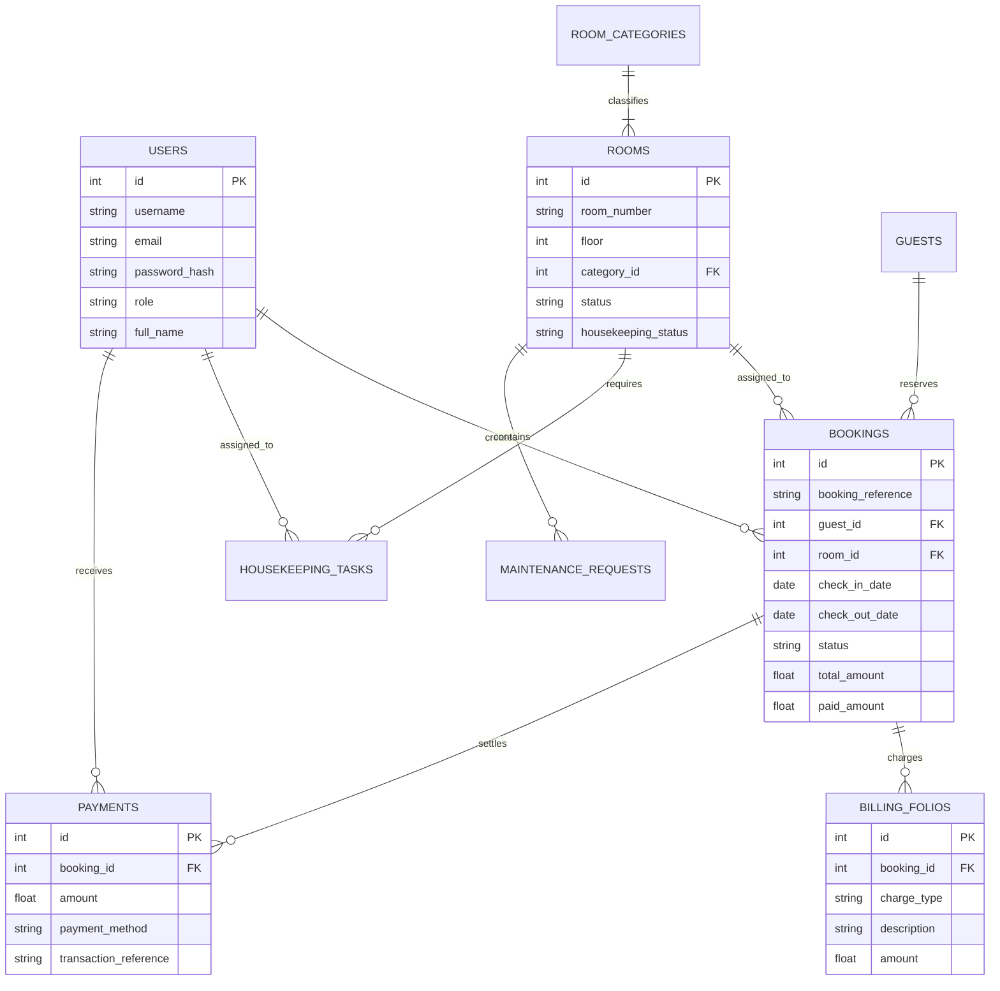

<div align="center">

# 🏨 Grandeur Hotel & Resort Management System (PMS)

### Enterprise-Grade Full-Stack Hospitality & Property Management Platform

[](https://opensource.org/licenses/MIT)
[](https://www.typescriptlang.org/)
[](https://react.dev/)
[](https://nodejs.org/)
[](https://tailwindcss.com/)
[](https://www.sqlite.org/)
[](http://makeapullrequest.com)

**Grandeur PMS** is a production-ready, full-stack Hotel and Resort Management System engineered for modern luxury hospitality operations. It combines an interactive real-time room matrix, front desk check-in/out engine, guest folio billing & POS, housekeeping dispatch board, CRM guest profiling, and executive financial KPI reporting into a single intuitive interface.

[Quick Start](#-quick-start) • [Key Features](#-key-features) • [Demo Accounts](#-demo-accounts) • [Architecture](#-architecture) • [Database Schema](#-database-schema) • [API Reference](#-api-endpoints) • [Docker](#-docker-deployment)

---

</div>

## ✨ Key Features

### 🛏️ Interactive Room Matrix & Floor Rack
- **Visual Floor-by-Floor Matrix**: Real-time status for 32 luxury rooms across 4 floors (Standard Terraces, Oceanfront Deluxe, Executive Suites, and Presidential Villas).
- **Multi-State Lifecycle Management**: Color-coded tracking for Available, Occupied, Reserved, In-Cleaning, and Maintenance.
- **Deep Room Inspection Modal**: Instant access to room amenities, current occupant profile, folio links, and housekeeping state overrides.

### 🛎️ Front Desk Expedited Check-In / Check-Out
- **One-Click Check-In**: Streamlined guest verification with digital RFID key card simulation and reservation lookup.
- **Folio Audit & Express Check-Out**: Automatically audits outstanding balances before releasing rooms, updating room status to `dirty`, and auto-dispatching checkout turnover tasks.
- **Walk-In Booking Wizard**: Instant registration for unscheduled arrivals with real-time rate & tax calculation.

### 📅 Reservation Engine & Dynamic Pricing
- **Conflict-Free Booking Engine**: Real-time room availability validation by date range and category capacity.
- **Automated Tax & Discount Calculations**: Configurable municipal occupancy tax (default 12%), custom discounts, and deposit accounting.
- **Multi-Channel Distribution Tagging**: Distinguishes direct website bookings, corporate accounts, OTAs (Booking.com, Expedia), and walk-ins.

### 🧹 Housekeeping & Facility Maintenance
- **Kanban Cleaning Board**: Three-stage turnover pipeline (`Dirty / Turnover Required` ➔ `In-Progress` ➔ `Inspected & Sanitized`).
- **Engineering Work Orders**: Report, track, and resolve facility issues (HVAC, plumbing, electrical, audio/video) with priority flags (`Urgent`, `High`, `Medium`, `Low`).
- **Auto-Sync Room States**: Transitioning cleaning tasks automatically synchronizes live room availability for the front desk.

### 🧾 Guest Folio, Point of Sale (POS) & Invoicing
- **Itemized Guest Ledger**: Post room dining, bar orders, wellness spa treatments, laundry, and mini-bar consumption directly to room accounts.
- **Multi-Method Payments**: Record settlements via credit card, cash, wire transfer, Stripe, or corporate accounts.
- **Printable Tax Invoices**: Formatted with custom `@media print` styling for crisp, professional A4 / Letter PDF exports and physical receipts.

### 👤 Guest Relationship CRM & VIP Loyalty
- **Tiered VIP Management**: Track guests across Standard, Silver, Gold, and Platinum VIP tiers.
- **Lifetime Hospitality Telemetry**: Cumulative historical stay tracking and total revenue spend aggregation.
- **Guest Preference Dossier**: Store personal requirements (feather-free pillows, high-floor preferences, anniversary champagne).

### 📊 Executive Financial Intelligence & Reporting
- **Core Industry KPIs**: Real-time tracking of **Occupancy Rate (%)**, **Average Daily Rate (ADR)**, and **RevPAR (Revenue Per Available Room)**.
- **7-Day Financial Velocity**: Interactive Recharts visualizations displaying daily revenue trajectories.
- **One-Click CSV Export**: Download complete operational and revenue reports for corporate accounting.

### 🛡️ Role-Based Access Control (RBAC) & Audit Log
- **Granular Permissions**: Built-in access profiles for General Managers (`admin`), Operations Managers (`manager`), Front Desk Receptionists (`receptionist`), and Cleaners (`housekeeper`).
- **Cryptographic Authentication**: JWT-signed session tokens and bcrypt password hashing.
- **Immutable Audit Trail**: Logs critical operations (check-ins, check-outs, price adjustments, status overrides) with timestamps and operator identity.

---

## 👥 Demo Accounts

The application includes built-in quick-login persona cards on the login screen. You can switch between roles in **1 click**:

| Role | Username | Password | Access Scope |
| :--- | :--- | :--- | :--- |
| **General Manager (Admin)** | `admin` | `admin123` | Full access to all operations, settings, staff management, and audit logs |
| **Operations Manager** | `manager` | `password123` | Room management, reservations, billing, analytics, and work orders |
| **Front Desk Receptionist** | `receptionist` | `password123` | Check-in/out desk, reservations, guest CRM, folios, and payment processing |
| **Housekeeping Lead** | `cleaner` | `password123` | Dedicated housekeeping matrix, cleaning tasks, and maintenance reports |

---

## 🏗️ Architecture

```mermaid
flowchart TD
    subgraph Frontend["Frontend Client (React 19 + TypeScript + Tailwind CSS)"]
        UI[Luxury Dashboard & Theme System]
        AuthCtx[Auth Context & Role Controller]
        APIClient[Typed REST API Service Client]
        Components[Room Matrix | Front Desk | Folios | Housekeeping | Analytics]
        UI --> Components
        Components --> APIClient
        AuthCtx --> APIClient
    end

    subgraph Backend["Backend API Server (Node.js + Express + TypeScript)"]
        Router[Express REST Routers]
        AuthMW[JWT & RBAC Middleware]
        Controllers[Auth | Rooms | Bookings | Billing | HK | Analytics]
        DBService[SQLite Repository & Transaction Engine]
        Router --> AuthMW
        AuthMW --> Controllers
        Controllers --> DBService
    end

    subgraph Storage["ACID Relational Storage"]
        SQLite[(hotel.db - Better-SQLite3 WAL Mode)]
    end

    APIClient -- "HTTP / REST (Bearer JWT)" --> Router
    DBService --> SQLite
```

---

## 🗄️ Database Schema



---

## 🚀 Quick Start

### Prerequisites
- **Node.js** v20+ or v22+
- **npm** v10+

### 1-Command Installation & Launch
Clone the repository and install all dependencies:

```bash
# Clone the repository
git clone https://github.com/your-username/grandeur-hotel-management-system.git
cd grandeur-hotel-management-system

# Install root, backend, and frontend dependencies in one command
npm run install:all

# Seed the database with 32 luxury suites and realistic guest data
npm run seed

# Start both Backend and Frontend in development mode with hot-reloading
npm run dev
```

The application will be live at:
- **Frontend SPA**: `http://localhost:5173`
- **Backend API**: `http://localhost:5000`
- **Health Check**: `http://localhost:5000/api/health`

---

## 🐳 Docker Deployment

Deploy the entire full-stack application with a single command using Docker:

```bash
# Build and run containerized PMS
docker compose up --build -d

# Check container status
docker compose ps
```

The application will be accessible at `http://localhost:5000`. Database records are persistently stored in the Docker `hotel-data` volume.

---

## 🔌 API Endpoints

All authenticated routes require header: `Authorization: Bearer <token>`

| Method | Endpoint | Description | Access |
| :--- | :--- | :--- | :--- |
| `POST` | `/api/auth/login` | Authenticate staff credentials & issue JWT | Public |
| `GET` | `/api/auth/me` | Fetch active user profile | Authenticated |
| `GET` | `/api/rooms` | Query rooms filtered by floor, status, or date | Authenticated |
| `PATCH`| `/api/rooms/:id/status` | Update operational or housekeeping condition | Authenticated |
| `GET` | `/api/bookings` | List reservations with status & date filters | Authenticated |
| `GET` | `/api/bookings/availability` | Real-time room vacancy check by date range | Authenticated |
| `POST` | `/api/bookings` | Create new reservation & calculate pricing | Authenticated |
| `PATCH`| `/api/bookings/:id/check-in` | Issue digital key & check in guest | Authenticated |
| `PATCH`| `/api/bookings/:id/check-out` | Audit folio, check out, and dispatch housekeeping | Authenticated |
| `GET` | `/api/guests` | Search guest CRM records by VIP status or query | Authenticated |
| `POST` | `/api/guests` | Register new guest profile | Authenticated |
| `GET` | `/api/housekeeping/tasks` | Fetch active cleaning tasks and priorities | Authenticated |
| `PATCH`| `/api/housekeeping/tasks/:id/status` | Advance cleaning pipeline (`in_progress`, `clean`) | Authenticated |
| `GET` | `/api/billing/folio/:bookingId` | Retrieve complete incidental ledger & balance | Authenticated |
| `POST` | `/api/billing/folio/:bookingId/charge` | Post restaurant, spa, or minibar charge to room | Authenticated |
| `POST` | `/api/billing/folio/:bookingId/payment` | Settle payment (Card, Cash, Wire Transfer) | Authenticated |
| `GET` | `/api/billing/invoice/:bookingId` | Export official tax invoice with company logo | Authenticated |
| `GET` | `/api/analytics/dashboard` | Live ADR, RevPAR, Occupancy %, and trend series | Admin, Manager |
| `GET` | `/api/analytics/reports` | Yield by distribution channel & top VIP spenders | Admin, Manager |
| `GET` | `/api/staff` | List staff accounts & permission tiers | Admin, Manager |
| `GET` | `/api/staff/audit-logs` | Retrieve operational security audit logs | Admin, Manager |

---

## 🧪 Testing

Run backend automated unit and integration tests:

```bash
cd backend
npm test
```

---

## 📂 Project Structure

```text
grandeur-hotel-management-system/
├── .github/
│   └── workflows/
│       └── ci.yml               # GitHub Actions CI workflow
├── backend/
│   ├── src/
│   │   ├── config/              # Environment configurations
│   │   ├── controllers/         # REST API controller handlers
│   │   ├── db/
│   │   │   ├── database.ts      # Better-SQLite3 WAL connection
│   │   │   ├── schema.sql       # Relational SQL schema & indexes
│   │   │   └── seed.ts          # Luxury resort demo data seeder
│   │   ├── middleware/          # JWT auth & error handling
│   │   ├── routes/              # Express API route declarations
│   │   ├── app.ts               # Express application initialization
│   │   └── server.ts            # Entrypoint listener
│   ├── tests/
│   │   └── api.test.ts          # Automated integration test suite
│   ├── package.json
│   └── tsconfig.json
├── frontend/
│   ├── src/
│   │   ├── components/
│   │   │   ├── billing/         # Folio modals & Printable Invoices
│   │   │   ├── bookings/        # New Reservation Wizard
│   │   │   ├── common/          # Modals, Badges, Toasts
│   │   │   ├── layout/          # Sidebar, Header, and Master Layout
│   │   │   └── rooms/           # Interactive Room Matrix Card
│   │   ├── context/             # AuthContext (RBAC) & ThemeContext
│   │   ├── pages/               # Dashboard, Rooms, Desk, CRM, Reports
│   │   ├── services/            # Type-safe API client
│   │   ├── types/               # TypeScript definitions
│   │   ├── utils/               # Currency, Date, and VIP badge formatters
│   │   ├── App.tsx
│   │   └── main.tsx
│   ├── package.json
│   ├── tailwind.config.js
│   └── vite.config.ts
├── docker-compose.yml           # Production Docker Compose orchestration
├── Dockerfile                   # Multi-stage production container build
├── package.json                 # Monorepo command orchestration
└── README.md                    # Documentation & Setup Guide
```

---

## 📄 License

This project is licensed under the MIT License - see the [LICENSE](LICENSE) file for details.

